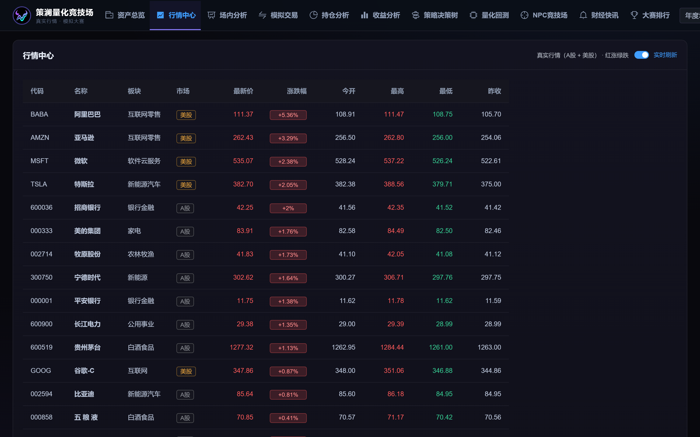
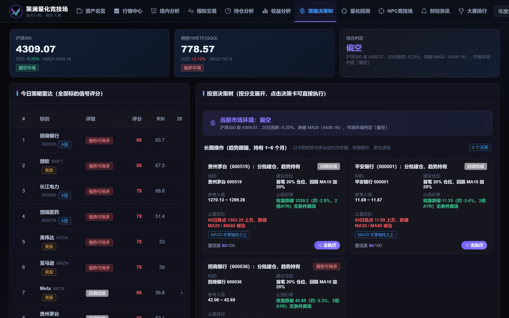
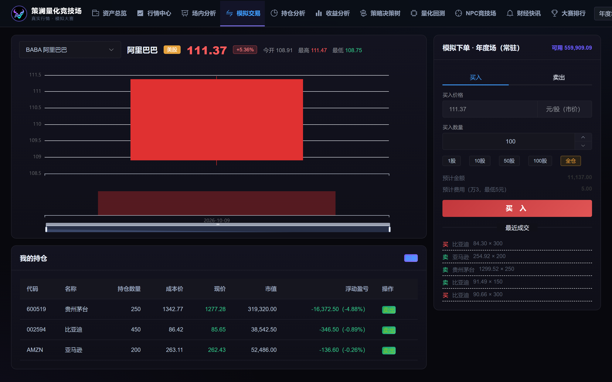
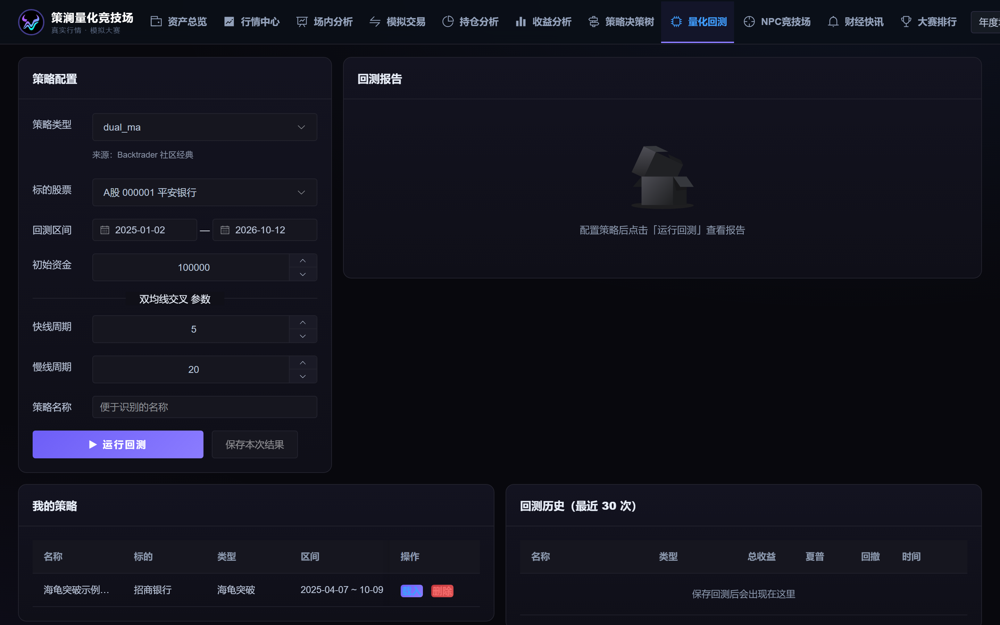

# 策澜量化竞技场 (Celang Quant Arena)

> 面向大学生模拟炒股大赛的模拟炒股与量化回测平台 · A股 + 美股真实行情 · AI 策略决策树 · NPC 交易者对战

  

## 项目简介

「策澜量化竞技场」是一个前后端分离的管理信息系统，面向高校模拟炒股大赛场景：

- **真实行情**：接入东方财富公开行情接口（主）与腾讯行情（备），覆盖 A 股 + 美股 24 只标的的实时报价与前复权日K，主源断连自动降级
- **模拟交易**：实时价撮合，双市场规则（A股整手 / 美股按股）、万三佣金 + 印花税费用模型、摊薄成本持仓、资产曲线精确对账
- **策略决策树（核心）**：自动计算全部标的的均线/MACD/RSI/布林等信号，融合大盘环境判定，生成长期操作 / 短期操作 / 交易技巧三分支的可执行决策卡（仓位、入场、止损、止盈、依据、置信度），一键直达下单
- **量化回测**：六种经典策略（双均线、MACD、RSI、布林带、海龟突破、动量趋势）参数化回测，防未来函数设计，输出年化 / 最大回撤 / 夏普 / 胜率并与基准对比
- **NPC 竞技场**：八位职业风格各异的机器人交易者（私募经理、游资敢死队、华尔街交易员、佛系定投学生……）基于真实行情自动对战
- **财经快讯**：东方财富 7×24 + 新浪滚动双源聚合，昨日收盘以来过滤，关键词规则利好/利空情绪分析与市场温度计
- **大赛运营**：年度常驻账户 + 管理员发布限时比赛（多账户资金隔离）、实时排行榜、赛程设置

## 界面预览

| 行情中心 | 策略决策树 |
| --- | --- |
|  |  |

| 模拟交易 | 量化回测 |
| --- | --- |
|  |  |

更多截图见 [docs/img](docs/img)。

## 技术栈

| 层次 | 技术 |
| --- | --- |
| 前端 | Vue 3 + Vite + Element Plus (Dark) + ECharts + Pinia + Vue Router + Axios |
| 后端 | FastAPI + SQLAlchemy 2.0 + PyJWT（PBKDF2 密码哈希） |
| 数据库 | SQLite（WAL 模式，日K本地缓存） |
| 行情数据 | 东方财富公开行情接口（主）+ 腾讯行情（备），含重试与自动降级 |

## 快速开始

```bash
# 1. 后端（首次先装依赖并拉取真实行情初始化）
cd backend
pip install -r requirements.txt
python seed.py
python -m uvicorn app.main:app --port 8002

# 2. 前端
cd frontend
npm install
npm run build        # 生产模式：构建后由后端直接托管

# 3. 浏览器访问
http://127.0.0.1:8002
```

开发模式：`npm run dev`（Vite 端口 5174，`/api` 自动代理到 8002）。

### 演示账号

| 角色 | 账号 | 密码 |
| --- | --- | --- |
| 管理员 | admin | admin123 |
| 投资者 | trader01 ~ trader05 | 123456 |

## 目录结构

```
quant-system/
├── backend/app/
│   ├── datasource.py    # 行情主备源（EM + 腾讯），重试/缓存/降级
│   ├── engine.py        # 指标库 + 六策略信号 + 回测引擎
│   ├── security.py      # JWT / PBKDF2 / RBAC 依赖
│   └── routers/         # auth / market / trade / advisor / quant /
│                        # npc / news / competition / admin
├── frontend/src/
│   ├── components/KLineChart.vue   # 通用K线组件
│   └── views/{admin,portal}/       # 管理端 + 用户端页面
└── docs/                # 开发文档构建脚本与截图
```

## 免责声明

- 本项目用于**教学与学习**，行情数据来自公开接口并可能存在延迟，不构成任何投资建议
- 模拟盘不涉及任何真实资金；请遵守所在学校与地区关于证券交易的相关规定
- 生产部署请修改 `backend/app/security.py` 中的 JWT 密钥，并将 SQLite 替换为生产级数据库

## License

[MIT](LICENSE)
